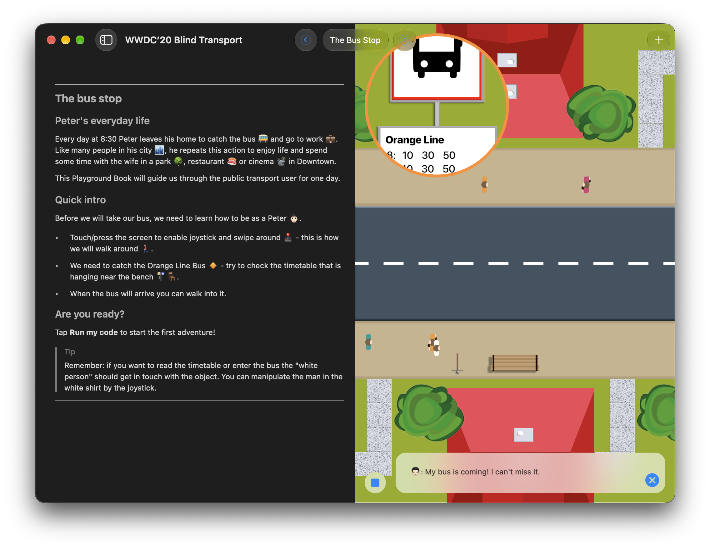
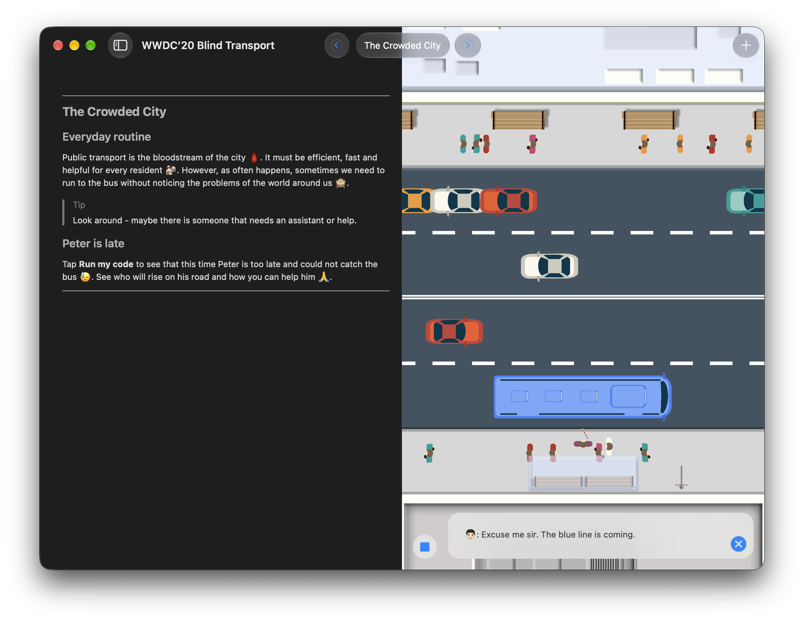
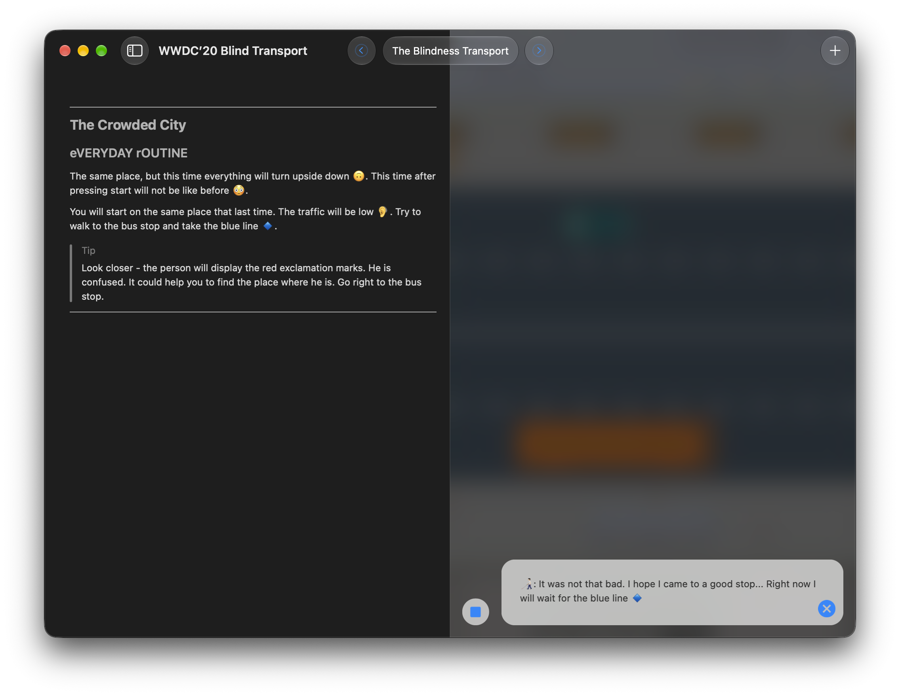
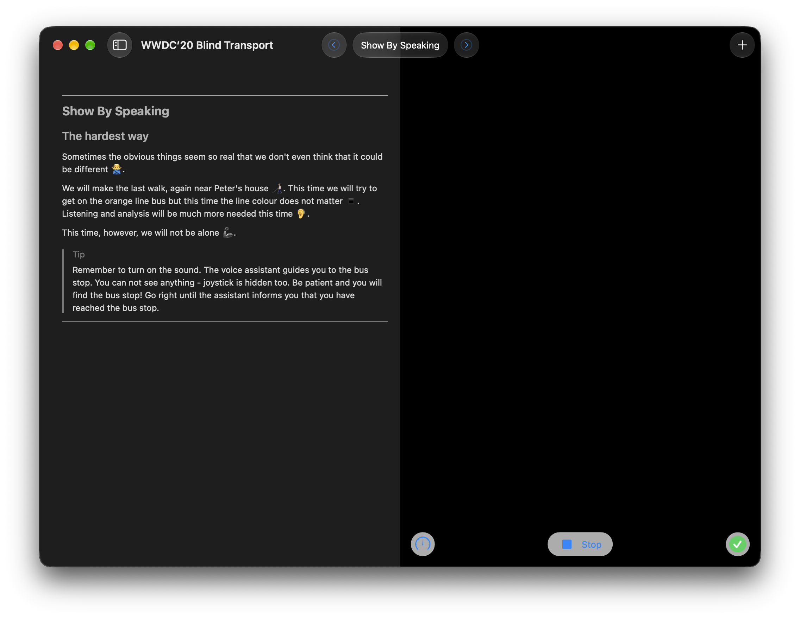

# WWDC20 — Blind Transport

> My **WWDC 2020 Swift Student Challenge** winning submission: a small top-down game about getting home by public transport — and how different that trip is for someone who can't see.

You play **Peter**, a regular commuter. Touch the screen to summon a virtual joystick, walk to the bus stop, read the timetable and board the bus. Over four pages, in two places — the quiet streets near Peter's home and a crowded city centre — the same journey is told from different perspectives:

1. **The Bus Stop** — a normal day: catch the orange-line bus near home.
2. **The Crowded City** — this time Peter misses his bus, notices a blind man at the stop and helps him find the right line.
3. **The Blindness Transport** — the same street near home, but you are the one who can't see well: blurred contours and confusion markers, find the stop and take the blue line.
4. **Show By Speaking** — the hardest version: no picture, no joystick. A voice assistant (`AVSpeechSynthesizer`) guides you to the stop; listen and find the bus.

The point of the story is how complicated public transport is for a passenger with a disability, and how much attention the people designing it should put on that passenger.

## Screenshots

<table>
  <tr>
    <td><b>1 · The Bus Stop</b> 
      </td>
    <td><b>2 · The Crowded City</b> 
      </td>
  </tr>
  <tr>
    <td><b>3 · The Blindness Transport</b> 
      </td>
    <td><b>4 · Show By Speaking</b> 
      </td>
  </tr>
</table>

## What's inside

A Swift Playground Book with a custom `City` module (UIKit + AVFoundation):

- `Models` — `World`, `Road`, `Sidewalk`, `Building`, `Bus`, `Car`, `Person`, `MainCharacter`, `BlindCharacter`
- `Actions` — joystick controller, traffic, pedestrians and collision handling
- `Controllers` — `CityViewController` and the page/hint logic
- Sprites and sound effects (engines, bus) in `PrivateResources`

## Run it

Open `WWDC’20 Blind Transport.playgroundbook` in **Swift Playgrounds on iPad** (AirDrop or the Files app), tap **Run my code** and walk to the bus stop. Turn the sound on — page 4 depends on it.

Built for Swift Playgrounds (Swift 5.1, iOS 12). Newer versions of the app may no longer open the legacy `.playgroundbook` format. `License.txt` is the Swift Playgrounds license shipped with the book template.
